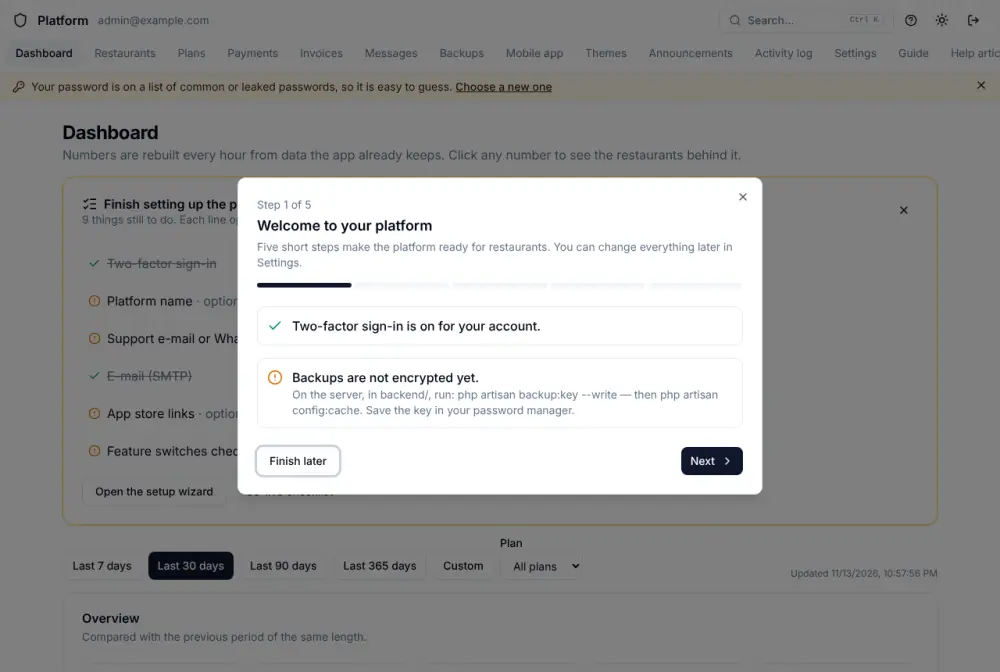

<!-- Written by `php artisan docs:admin-guide` from backend/resources/help/platform. Edit those files, not this one. -->

# 8. The first Super Admin and two-factor

*Make your own account on the server, then turn on 2FA.*

Super Admins are made on the server, not in the app. In `backend/`:

```bash
php artisan super:create
```

It asks for your name, e-mail and a password (typed twice, not shown).

1. Sign in at **https://your-domain/<SUPER_ADMIN_PATH>/sign-in**. This address is yours only: it is set by `SUPER_ADMIN_PATH` in `.env` (default `super`; choose something hard to guess). Restaurant teams sign in at https://your-domain/signin, which doesn't let Super Admins in.
2. You see only **Set up two-factor**.
3. Scan the QR code with an authenticator app. Type the code.
4. **Save the recovery codes** in your password manager.

Now the whole panel opens, and the **setup wizard** starts. Five short pages:

1. **Welcome**: two-factor and the backup key.
2. **Your platform**: name, support e-mail, WhatsApp, colour, logo.
3. **Plans and prices**: price and limits of each plan.
4. **E-mail, app and sign-up**: send yourself a test e-mail, Firebase status, open or closed sign-up.
5. **Features and demo data**: switch off what you don't offer, delete demo restaurants.



**Finish later** is fine. The dashboard then shows a list of what is still to do. Open the wizard again from **Settings → Setup wizard**.

Next: [Firebase for the app](firebase.md).
