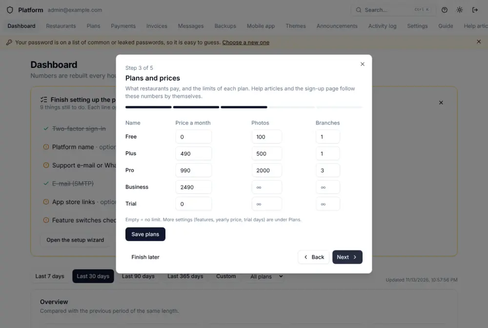

<!-- Written by `php artisan docs:admin-guide` from backend/resources/help/platform. Edit those files, not this one. -->

# Plans and limits

*Prices, limits and features of each plan.*

Open **Plans**. Today's plans:

*The live list of plans, with prices and limits, is shown here in the panel (Super Admin → Guide).*

**Change a plan:** tap it. You can change:

- **Name**, **Price**, **Price for a year**, **Currency**, **Trial days**.
- **Limits**: empty = unlimited. Photos and branches are counted on the standard plans.
- **Features**: which features this plan includes.
- **Shown at sign-up** and **Can be chosen**.

Help articles, the landing page and the sign-up page read prices and limits **live** from here. You never need to change a text when you change a price.

Lowering a limit doesn't delete anything. A restaurant over the limit just can't add more.

**Old plans:** a plan can be replaced by another. Its restaurants move to the new plan when their paid time ends.
